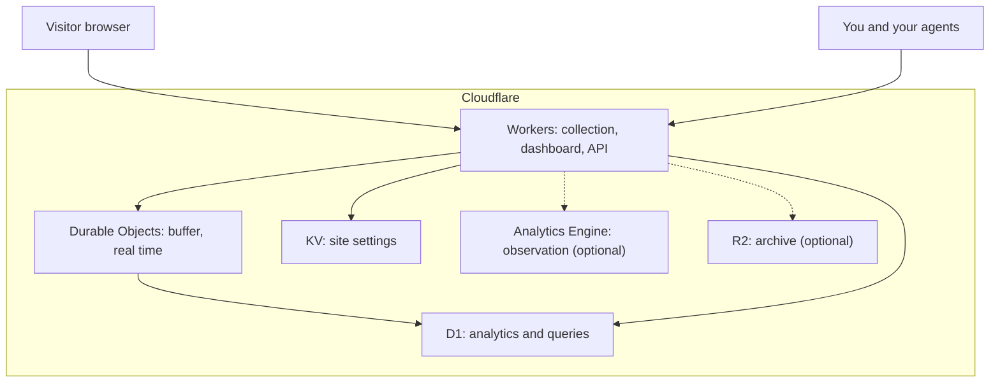

<div align="center">

<a href="https://insightflare.net/en?utm_source=github&amp;utm_medium=referral&amp;utm_campaign=website&amp;utm_content=readme_logo"></a>

# InsightFlare

### Light as web analytics. Deep as product analytics.

A script under 4 KB brings traffic, visitor journeys, funnels, retention and behavior-based audiences into one dashboard. Deploy on your own Cloudflare account, without maintaining servers.

[Website](https://insightflare.net/en?utm_source=github&utm_medium=referral&utm_campaign=website&utm_content=readme_header) · [Documentation](https://insightflare.net/en/docs?utm_source=github&utm_medium=referral&utm_campaign=docs&utm_content=readme_header) · [Live demo](https://demo.insightflare.net/en/app/xeoos-team/dailypulse-news?utm_source=github&utm_medium=referral&utm_campaign=demo&utm_content=readme_header)

[](https://deploy.insightflare.net/en?utm_source=github&utm_medium=referral&utm_campaign=deploy&utm_content=readme_hero)

[](https://github.com/RavelloH/InsightFlare/stargazers) [](https://github.com/RavelloH/InsightFlare/releases) [](/LICENSE)

<!-- auto-readme-i18n-switcher start -->
| English | [日本語](/.github/readme/README.ja.md) | [中文（台灣）](/.github/readme/README.zh-tw.md) | [中文](/.github/readme/README.zh.md) |
<!-- auto-readme-i18n-switcher end -->

</div>

<a href="https://demo.insightflare.net/en/app/xeoos-team/dailypulse-news?utm_source=github&amp;utm_medium=referral&amp;utm_campaign=demo&amp;utm_content=readme_screenshot"></a>

<div align="center">

<table>
  <tr>
    <td width="33%" align="center"><br>Tracking script</td>
    <td width="33%" align="center"><br>Daily events on a free account (tested)</td>
    <td width="33%" align="center"><br>Software license fee</td>
  </tr>
</table>

</div>

## Why InsightFlare?

- **Start with one lightweight script.** Automatically collect page views, referrers, UTM campaigns, devices, locations and Core Web Vitals with a cookie-free script under 4 KB. Change tracking settings without redeploying your website.
- **See the whole picture.** Follow live visitors and traffic, then explore pages, acquisition channels and real-user performance in the same dashboard.
- **Compare periods or audiences in place.** Overlay comparison data on metric cards, trends, tables, funnels and retention reports. Give the comparison its own filter to compare two groups of visitors directly.
- **Go deeper without per-event software fees.** Analyze custom events and their properties, conversion funnels, goals and cohort retention; no separate product analytics subscription is needed.
- **Ask precise questions with advanced filters.** Define audiences by what visitors did, how often, in what order and within what time window. Combine nested AND/OR/NOT conditions, event properties, aggregations and ordered sequences in a visual builder or expression. Every applicable report then focuses on the selected audience.
- **Understand every visitor.** Open a visitor's timeline to inspect sessions, referrers, pages and events with their full payloads.
- **Let AI agents query your data.** Published Skills, versioned OpenAPI and scoped API keys allow agents to investigate data and manage saved analyses with appropriate permissions.
- **Own your infrastructure and data.** One-click deployment to your Cloudflare account, automatically scaling Workers, configurable visitor identification and MIT-licensed self-hosted software.
- **Work together and stay informed.** Manage multiple sites and teams, share read-only reports, configure notifications and inspect bot traffic.

[Try advanced filters with the real engine](https://insightflare.net/en/features/filters?utm_source=github&utm_medium=referral&utm_campaign=features&utm_content=readme_why_filters) · [Compare periods and audiences](https://insightflare.net/en/docs/usage/comparison?utm_source=github&utm_medium=referral&utm_campaign=docs&utm_content=readme_why_compare)

## Quick start

Install the latest official build without forking, compiling or installing Wrangler.

[](https://deploy.insightflare.net/en?utm_source=github&utm_medium=referral&utm_campaign=deploy&utm_content=readme_quick_start)

1. Connect to Cloudflare, select an account and review the deployment plan.
2. Choose an address and administrator password, then install.
3. Sign in, create a site and paste its tracking snippet into your pages.
4. Visit your site and confirm activity in the real-time view.

[Quick start](https://insightflare.net/en/docs/getting-started/quick-start?utm_source=github&utm_medium=referral&utm_campaign=docs&utm_content=readme_guide) · [Manual deployment](https://insightflare.net/en/docs/deployment/manual-deployment?utm_source=github&utm_medium=referral&utm_campaign=docs&utm_content=readme_guide)

## Explore features

<table>
  <tr>
    <td width="50%" valign="top" align="center"><a href="https://insightflare.net/en/features?utm_source=github&amp;utm_medium=referral&amp;utm_campaign=features&amp;utm_content=readme_traffic"><br><strong>Traffic &amp; acquisition</strong></a><br>Live traffic, pages, referrers and campaigns.</td>
    <td width="50%" valign="top" align="center"><a href="https://insightflare.net/en/features?utm_source=github&amp;utm_medium=referral&amp;utm_campaign=features&amp;utm_content=readme_journeys"><br><strong>Sessions &amp; visitor journeys</strong></a><br>Trace visits and custom events.</td>
  </tr>
  <tr>
    <td width="50%" valign="top" align="center"><a href="https://insightflare.net/en/features/funnels?utm_source=github&amp;utm_medium=referral&amp;utm_campaign=features&amp;utm_content=readme_funnels"><br><strong>Funnels &amp; goals</strong></a><br>Find drop-off by session or visitor.</td>
    <td width="50%" valign="top" align="center"><a href="https://insightflare.net/en/features/retention?utm_source=github&amp;utm_medium=referral&amp;utm_campaign=features&amp;utm_content=readme_retention"><br><strong>Retention</strong></a><br>See who returns, grouped by first visit.</td>
  </tr>
  <tr>
    <td width="50%" valign="top" align="center"><a href="https://insightflare.net/en/features/filters?utm_source=github&amp;utm_medium=referral&amp;utm_campaign=features&amp;utm_content=readme_filters"><br><strong>Advanced filters & custom events</strong></a><br>Describe audiences by behavior, attributes and sequence.</td>
    <td width="50%" valign="top" align="center"><a href="https://insightflare.net/en/features/experience?utm_source=github&amp;utm_medium=referral&amp;utm_campaign=features&amp;utm_content=readme_experience"><br><strong>Real user experience</strong></a><br>Core Web Vitals, browsers and devices.</td>
  </tr>
  <tr>
    <td width="50%" valign="top" align="center"><a href="https://insightflare.net/en/features/geo?utm_source=github&amp;utm_medium=referral&amp;utm_campaign=features&amp;utm_content=readme_geo"><br><strong>Geo intelligence</strong></a><br>Drill down from countries to cities.</td>
    <td width="50%" valign="top" align="center"><a href="https://insightflare.net/en/features/operations?utm_source=github&amp;utm_medium=referral&amp;utm_campaign=features&amp;utm_content=readme_operations"><br><strong>Observability &amp; protection</strong></a><br>Request observation, bot rules and operational visibility.</td>
  </tr>
</table>

[Explore all features](https://insightflare.net/en/features?utm_source=github&utm_medium=referral&utm_campaign=features&utm_content=readme_gallery)

<details>
<summary>Full feature gallery (62 screenshots)</summary>

### Traffic overview & acquisition

<table>
  <tr>
    <td width="33%" align="center"><a href="/.github/screenshot/001.webp"></a></td>
    <td width="33%" align="center"><a href="/.github/screenshot/002.webp"></a></td>
    <td width="33%" align="center"><a href="/.github/screenshot/003.webp"></a></td>
  </tr>
  <tr>
    <td width="33%" align="center"><a href="/.github/screenshot/004.webp"></a></td>
    <td width="33%" align="center"><a href="/.github/screenshot/005.webp"></a></td>
    <td width="33%" align="center"><a href="/.github/screenshot/006.webp"></a></td>
  </tr>
  <tr>
    <td width="33%" align="center"><a href="/.github/screenshot/007.webp"></a></td>
    <td width="33%" align="center"><a href="/.github/screenshot/008.webp"></a></td>
    <td width="33%" align="center"><a href="/.github/screenshot/009.webp"></a></td>
  </tr>
  <tr>
    <td width="33%" align="center"><a href="/.github/screenshot/010.webp"></a></td>
    <td width="33%" align="center"><a href="/.github/screenshot/011.webp"></a></td>
    <td width="33%" align="center"><a href="/.github/screenshot/012.webp"></a></td>
  </tr>
  <tr>
    <td width="33%" align="center"><a href="/.github/screenshot/013.webp"></a></td>
    <td width="33%" align="center"><a href="/.github/screenshot/014.webp"></a></td>
    <td width="33%"></td>
  </tr>
</table>

### Events, sessions & visitor journeys

<table>
  <tr>
    <td width="33%" align="center"><a href="/.github/screenshot/015.webp"></a></td>
    <td width="33%" align="center"><a href="/.github/screenshot/016.webp"></a></td>
    <td width="33%" align="center"><a href="/.github/screenshot/017.webp"></a></td>
  </tr>
  <tr>
    <td width="33%" align="center"><a href="/.github/screenshot/018.webp"></a></td>
    <td width="33%" align="center"><a href="/.github/screenshot/019.webp"></a></td>
    <td width="33%" align="center"><a href="/.github/screenshot/020.webp"></a></td>
  </tr>
  <tr>
    <td width="33%" align="center"><a href="/.github/screenshot/021.webp"></a></td>
    <td width="33%" align="center"><a href="/.github/screenshot/022.webp"></a></td>
    <td width="33%" align="center"><a href="/.github/screenshot/023.webp"></a></td>
  </tr>
  <tr>
    <td width="33%" align="center"><a href="/.github/screenshot/024.webp"></a></td>
    <td width="33%" align="center"><a href="/.github/screenshot/025.webp"></a></td>
    <td width="33%"></td>
  </tr>
</table>

### Audience, devices & geography

<table>
  <tr>
    <td width="33%" align="center"><a href="/.github/screenshot/026.webp"></a></td>
    <td width="33%" align="center"><a href="/.github/screenshot/027.webp"></a></td>
    <td width="33%" align="center"><a href="/.github/screenshot/028.webp"></a></td>
  </tr>
  <tr>
    <td width="33%" align="center"><a href="/.github/screenshot/029.webp"></a></td>
    <td width="33%" align="center"><a href="/.github/screenshot/030.webp"></a></td>
    <td width="33%" align="center"><a href="/.github/screenshot/031.webp"></a></td>
  </tr>
  <tr>
    <td width="33%" align="center"><a href="/.github/screenshot/032.webp"></a></td>
    <td width="33%" align="center"><a href="/.github/screenshot/033.webp"></a></td>
    <td width="33%" align="center"><a href="/.github/screenshot/034.webp"></a></td>
  </tr>
  <tr>
    <td width="33%" align="center"><a href="/.github/screenshot/035.webp"></a></td>
    <td width="33%" align="center"><a href="/.github/screenshot/036.webp"></a></td>
    <td width="33%"></td>
  </tr>
</table>

### Configuration, teams & sharing

<table>
  <tr>
    <td width="33%" align="center"><a href="/.github/screenshot/037.webp"></a></td>
    <td width="33%" align="center"><a href="/.github/screenshot/038.webp"></a></td>
    <td width="33%" align="center"><a href="/.github/screenshot/039.webp"></a></td>
  </tr>
  <tr>
    <td width="33%" align="center"><a href="/.github/screenshot/040.webp"></a></td>
    <td width="33%" align="center"><a href="/.github/screenshot/041.webp"></a></td>
    <td width="33%" align="center"><a href="/.github/screenshot/042.webp"></a></td>
  </tr>
  <tr>
    <td width="33%" align="center"><a href="/.github/screenshot/043.webp"></a></td>
    <td width="33%" align="center"><a href="/.github/screenshot/044.webp"></a></td>
    <td width="33%" align="center"><a href="/.github/screenshot/045.webp"></a></td>
  </tr>
  <tr>
    <td width="33%" align="center"><a href="/.github/screenshot/046.webp"></a></td>
    <td width="33%" align="center"><a href="/.github/screenshot/047.webp"></a></td>
    <td width="33%" align="center"><a href="/.github/screenshot/048.webp"></a></td>
  </tr>
</table>

### Deep event analysis & funnels

<table>
  <tr>
    <td width="33%" align="center"><a href="/.github/screenshot/049.webp"></a></td>
    <td width="33%" align="center"><a href="/.github/screenshot/050.webp"></a></td>
    <td width="33%" align="center"><a href="/.github/screenshot/051.webp"></a></td>
  </tr>
  <tr>
    <td width="33%" align="center"><a href="/.github/screenshot/052.webp"></a></td>
    <td width="33%" align="center"><a href="/.github/screenshot/053.webp"></a></td>
    <td width="33%" align="center"><a href="/.github/screenshot/054.webp"></a></td>
  </tr>
</table>

### Operations, alerts & bot protection

<table>
  <tr>
    <td width="33%" align="center"><a href="/.github/screenshot/055.webp"></a></td>
    <td width="33%" align="center"><a href="/.github/screenshot/056.webp"></a></td>
    <td width="33%" align="center"><a href="/.github/screenshot/057.webp"></a></td>
  </tr>
  <tr>
    <td width="33%" align="center"><a href="/.github/screenshot/058.webp"></a></td>
    <td width="33%" align="center"><a href="/.github/screenshot/059.webp"></a></td>
    <td width="33%" align="center"><a href="/.github/screenshot/060.webp"></a></td>
  </tr>
  <tr>
    <td width="33%" align="center"><a href="/.github/screenshot/061.webp"></a></td>
    <td width="33%" align="center"><a href="/.github/screenshot/062.webp"></a></td>
    <td width="33%"></td>
  </tr>
</table>

</details>

## AI agents & API

Let Claude Code, Codex, OpenClaw or your own tools explore analytics through published Skills and scoped API keys. Send your agent the instruction below, replacing the domain:

```text
Read https://your-instance.example.com/.well-known/skills.json, connect to this analytics system, and guide me through authorization.
```

> **Which device converts better from pricing to deployment, and where do mobile visitors drop off?**
>
> An agent can compare device funnels, inspect performance and traffic sources, and save a funnel for later comparison with the appropriate permissions.

[Agent access](https://insightflare.net/en/docs/ai-and-api/connect-an-agent?utm_source=github&utm_medium=referral&utm_campaign=docs&utm_content=readme_guide) · [API reference](https://insightflare.net/en/docs/api?utm_source=github&utm_medium=referral&utm_campaign=docs&utm_content=readme_guide)

## Self-hosting & cost

InsightFlare runs on Cloudflare Workers, Durable Objects, D1 and KV. Analytics Engine and R2 are optional. Writes are buffered and batched; the edge network serves collection and dashboards.



**10,000+ events per day on a free Cloudflare account**, as reported by our website's test. Actual usage depends on traffic, query frequency, data size and plan limits.

[Deployment, architecture & cost](https://insightflare.net/en/self-hosting?utm_source=github&utm_medium=referral&utm_campaign=website&utm_content=readme_cost)

## Privacy & data ownership

The tracker does not set or read cookies. Raw IP addresses are not stored with normal visitor records; when Analytics Engine is enabled, IPs of requests classified as bots and blocked may be recorded for investigation. You can also change the tracking mode in site settings to adapt to applicable regulations.

[Cost & privacy](https://insightflare.net/en/docs/getting-started/cost-and-privacy?utm_source=github&utm_medium=referral&utm_campaign=docs&utm_content=readme_guide) · [Visitor identification](https://insightflare.net/en/docs/tracking/privacy?utm_source=github&utm_medium=referral&utm_campaign=docs&utm_content=readme_guide)

## Documentation

<table>
  <tr>
    <td><strong>Getting started</strong></td>
    <td><a href="https://insightflare.net/en/docs/getting-started/quick-start?utm_source=github&amp;utm_medium=referral&amp;utm_campaign=docs&amp;utm_content=readme_guide">Quick start</a> · <a href="https://insightflare.net/en/docs/tracking?utm_source=github&amp;utm_medium=referral&amp;utm_campaign=docs&amp;utm_content=readme_guide">Install tracking</a> · <a href="https://insightflare.net/en/docs/getting-started/cost-and-privacy?utm_source=github&amp;utm_medium=referral&amp;utm_campaign=docs&amp;utm_content=readme_guide">Cost &amp; privacy</a></td>
  </tr>
  <tr>
    <td><strong>Analytics</strong></td>
    <td><a href="https://insightflare.net/en/docs/usage/filters?utm_source=github&amp;utm_medium=referral&amp;utm_campaign=docs&amp;utm_content=readme_guide">Advanced filters</a> · <a href="https://insightflare.net/en/docs/usage/funnels-and-goals?utm_source=github&amp;utm_medium=referral&amp;utm_campaign=docs&amp;utm_content=readme_guide">Funnels &amp; goals</a> · <a href="https://insightflare.net/en/docs/usage/retention?utm_source=github&amp;utm_medium=referral&amp;utm_campaign=docs&amp;utm_content=readme_guide">Retention</a></td>
  </tr>
  <tr>
    <td><strong>Tracking</strong></td>
    <td><a href="https://insightflare.net/en/docs/tracking/custom-events?utm_source=github&amp;utm_medium=referral&amp;utm_campaign=docs&amp;utm_content=readme_guide">Custom events</a> · <a href="https://insightflare.net/en/docs/tracking/identify?utm_source=github&amp;utm_medium=referral&amp;utm_campaign=docs&amp;utm_content=readme_guide">Identify users</a> · <a href="https://insightflare.net/en/docs/tracking/tracking-settings?utm_source=github&amp;utm_medium=referral&amp;utm_campaign=docs&amp;utm_content=readme_guide">Tracking settings</a></td>
  </tr>
  <tr>
    <td><strong>Deployment & operations</strong></td>
    <td><a href="https://insightflare.net/en/docs/deployment/updating?utm_source=github&amp;utm_medium=referral&amp;utm_campaign=docs&amp;utm_content=readme_guide">Updates</a> · <a href="https://insightflare.net/en/docs/deployment/analytics-engine?utm_source=github&amp;utm_medium=referral&amp;utm_campaign=docs&amp;utm_content=readme_guide">Analytics Engine</a> · <a href="https://insightflare.net/en/docs/deployment/manual-deployment?utm_source=github&amp;utm_medium=referral&amp;utm_campaign=docs&amp;utm_content=readme_guide">Manual deployment</a></td>
  </tr>
  <tr>
    <td><strong>Integration & development</strong></td>
    <td><a href="https://insightflare.net/en/docs/ai-and-api/connect-an-agent?utm_source=github&amp;utm_medium=referral&amp;utm_campaign=docs&amp;utm_content=readme_guide">Agent access</a> · <a href="https://insightflare.net/en/docs/api?utm_source=github&amp;utm_medium=referral&amp;utm_campaign=docs&amp;utm_content=readme_guide">API reference</a> · <a href="https://insightflare.net/en/docs/deployment/local-development?utm_source=github&amp;utm_medium=referral&amp;utm_campaign=docs&amp;utm_content=readme_guide">Local development</a></td>
  </tr>
</table>

[Configuration](https://insightflare.net/en/docs/reference/configuration?utm_source=github&utm_medium=referral&utm_campaign=docs&utm_content=readme_guide) · [R2 archive](https://insightflare.net/en/docs/deployment/r2-archive?utm_source=github&utm_medium=referral&utm_campaign=docs&utm_content=readme_guide) · [Commands](https://insightflare.net/en/docs/reference/commands?utm_source=github&utm_medium=referral&utm_campaign=docs&utm_content=readme_guide) · [FAQ](https://insightflare.net/en/docs/reference/faq?utm_source=github&utm_medium=referral&utm_campaign=docs&utm_content=readme_guide)

## Development

**TypeScript · React · TanStack Start · Cloudflare Workers · D1 · Durable Objects**

Requires Node.js 24 and pnpm 10.33. Configure .dev.vars according to the local development guide.

```bash
git clone https://github.com/RavelloH/InsightFlare
cd InsightFlare
pnpm install
pnpm run db:migrate:local
cp .dev.vars.example .dev.vars
```

After configuring the environment, run:

```bash
pnpm run dev
```

For UI-only work, run `pnpm run dev:ui` in Demo Mode without a database or secrets.

[Local development](https://insightflare.net/en/docs/deployment/local-development?utm_source=github&utm_medium=referral&utm_campaign=docs&utm_content=readme_guide) · [Contributing guide](/CONTRIBUTING.md)

## Community & ecosystem

InsightFlare is supported by independent open-source projects maintained in the organization and by its author.

<table>
  <tr>
    <td><a href="https://github.com/InsightFlare/deploy"><strong>Deploy</strong></a></td>
    <td>One-click installation and updates.</td>
  </tr>
  <tr>
    <td><a href="https://github.com/InsightFlare/asn-blocklist"><strong>asn-blocklist</strong></a></td>
    <td>ASN classification from PeeringDB.</td>
  </tr>
  <tr>
    <td><a href="https://github.com/InsightFlare/map-relay"><strong>map-relay</strong></a></td>
    <td>CARTO vector basemap proxy.</td>
  </tr>
  <tr>
    <td><a href="https://github.com/RavelloH/can-i-use-api"><strong>can-i-use-api</strong></a></td>
    <td>Static Can I Use compatibility API.</td>
  </tr>
  <tr>
    <td><a href="https://github.com/RavelloH/iso-3166-2-locale"><strong>iso-3166-2-locale</strong></a></td>
    <td>Multilingual geographical names.</td>
  </tr>
  <tr>
    <td><a href="https://gist.github.com/RavelloH/08cdb1493d09d2ad1eb0cf17d06e3078"><strong>meta</strong></a></td>
    <td>Webpage metadata extraction (Gist).</td>
  </tr>
</table>

[Explore the open-source ecosystem](https://insightflare.net/en/open-source?utm_source=github&utm_medium=referral&utm_campaign=website&utm_content=readme_ecosystem)

[Organization](https://github.com/InsightFlare) · [Report an issue](https://github.com/RavelloH/InsightFlare/issues) · [Contributing guide](/CONTRIBUTING.md) · [Releases](https://github.com/RavelloH/InsightFlare/releases)

## License

[MIT](/LICENSE) Copyright 2026 RavelloH

---

<div align="center">

### Start understanding your audience.

[](https://deploy.insightflare.net/en?utm_source=github&utm_medium=referral&utm_campaign=deploy&utm_content=readme_footer)

[Website](https://insightflare.net/en?utm_source=github&utm_medium=referral&utm_campaign=website&utm_content=readme_footer) · [Live demo](https://demo.insightflare.net/en/app/xeoos-team/dailypulse-news?utm_source=github&utm_medium=referral&utm_campaign=demo&utm_content=readme_footer)

</div>
