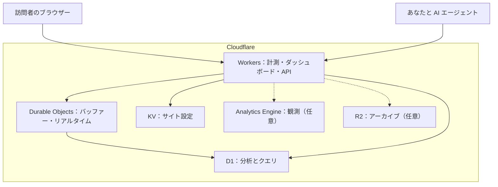

<div align="center">

<a href="https://insightflare.net/ja?utm_source=github&amp;utm_medium=referral&amp;utm_campaign=website&amp;utm_content=readme_logo"></a>

# InsightFlare

### ウェブ解析の手軽さ。プロダクト分析の深さ。

4 KB 未満のスクリプトで、トラフィック、訪問経路、ファネル、リテンション、行動別オーディエンスを一つのダッシュボードに。自分の Cloudflare アカウントにデプロイでき、サーバーの管理は不要です。

[公式サイト](https://insightflare.net/ja?utm_source=github&utm_medium=referral&utm_campaign=website&utm_content=readme_header) · [ドキュメント](https://insightflare.net/ja/docs?utm_source=github&utm_medium=referral&utm_campaign=docs&utm_content=readme_header) · [ライブデモ](https://demo.insightflare.net/ja/app/xeoos-team/dailypulse-news?utm_source=github&utm_medium=referral&utm_campaign=demo&utm_content=readme_header)

[](https://deploy.insightflare.net/ja?utm_source=github&utm_medium=referral&utm_campaign=deploy&utm_content=readme_hero)

[](https://github.com/RavelloH/InsightFlare/stargazers) [](https://github.com/RavelloH/InsightFlare/releases) [](/LICENSE)

<!-- auto-readme-i18n-switcher start -->
| [English](/.github/readme/README.en.md) | 日本語 | [中文（台灣）](/.github/readme/README.zh-tw.md) | [中文](/.github/readme/README.zh.md) |
<!-- auto-readme-i18n-switcher end -->

</div>

<a href="https://demo.insightflare.net/ja/app/xeoos-team/dailypulse-news?utm_source=github&amp;utm_medium=referral&amp;utm_campaign=demo&amp;utm_content=readme_screenshot"></a>

<div align="center">

<table>
  <tr>
    <td width="33%" align="center"><br>トラッキングスクリプト</td>
    <td width="33%" align="center"><br>無料アカウントでの1日あたり実測イベント数</td>
    <td width="33%" align="center"><br>ソフトウェア利用料</td>
  </tr>
</table>

</div>

## InsightFlare を選ぶ理由

- **スクリプトをひとつ追加するだけ。** 4 KB 未満の Cookie を使わないスクリプトでページビュー、流入元、UTM、端末、地域、Core Web Vitals を自動計測。フロントエンドを再デプロイせずに計測設定を変更できます。
- **同じデータから全体像を把握。** リアルタイムの訪問者、ページ、流入経路、実ユーザーのパフォーマンスを一つのダッシュボードで確認できます。
- **期間やオーディエンスをレポート上で比較。** 指標カード、トレンド、表、ファネル、リテンションに比較データを表示。比較側に独立したフィルターを設定して二つの訪問者グループを直接比較できます。
- **イベント数によるソフトウェア課金なしでプロダクト分析。** 属性付きカスタムイベント、コンバージョンファネル、目標、コホート別リテンションまで、別の分析サービスを契約する必要はありません。
- **高度なフィルターでオーディエンスを正確に絞り込む。** 訪問者の行動、回数、順序、時間間隔で抽出。ビジュアルビルダーや式でネストした AND / OR / NOT、イベント属性、集計、順序付きシーケンスを組み合わせ、トレンドからリテンションまで対象レポートを絞り込めます。
- **訪問者ごとの完全なタイムライン。** セッション、流入元、閲覧ページ、イベントとその属性を時系列で確認できます。
- **AI エージェントにデータを問い合わせる。** Skills、バージョン付き OpenAPI、権限を限定した API キーで分析や保存済み分析の管理ができます。
- **自分のインフラ、自分のデータ。** 自分の Cloudflare アカウントへワンクリックでデプロイ。Workers の自動拡張、設定可能な訪問者識別、MIT ライセンスのセルフホスト版。
- **チームでの利用にも対応。** 複数のチームとサイト、読み取り専用リンク、通知設定、ボットトラフィックの個別観測を利用できます。

[実際の高度なフィルターエンジンを試す](https://insightflare.net/ja/features/filters?utm_source=github&utm_medium=referral&utm_campaign=features&utm_content=readme_why_filters) · [期間とオーディエンスの比較](https://insightflare.net/ja/docs/usage/comparison?utm_source=github&utm_medium=referral&utm_campaign=docs&utm_content=readme_why_compare)

## クイックスタート

Fork、ビルド、Wrangler のインストールなしで最新の公式ビルドを導入できます。

[](https://deploy.insightflare.net/ja?utm_source=github&utm_medium=referral&utm_campaign=deploy&utm_content=readme_quick_start)

1. Cloudflare に接続し、アカウントを選択してデプロイ計画を確認します。
2. アクセス先と管理者パスワードを選び、インストールします。
3. ログインしてサイトを追加し、計測スクリプトをページに貼り付けます。
4. サイトにアクセスし、リアルタイム画面でデータの到着を確認します。

[クイックスタート](https://insightflare.net/ja/docs/getting-started/quick-start?utm_source=github&utm_medium=referral&utm_campaign=docs&utm_content=readme_guide) · [手動デプロイ](https://insightflare.net/ja/docs/deployment/manual-deployment?utm_source=github&utm_medium=referral&utm_campaign=docs&utm_content=readme_guide)

## 機能を探索

<table>
  <tr>
    <td width="50%" valign="top" align="center"><a href="https://insightflare.net/ja/features?utm_source=github&amp;utm_medium=referral&amp;utm_campaign=features&amp;utm_content=readme_traffic"><br><strong>トラフィックと流入</strong></a><br>リアルタイム、ページ、流入元、キャンペーン。</td>
    <td width="50%" valign="top" align="center"><a href="https://insightflare.net/ja/features?utm_source=github&amp;utm_medium=referral&amp;utm_campaign=features&amp;utm_content=readme_journeys"><br><strong>セッションと訪問経路</strong></a><br>訪問経路とカスタムイベント。</td>
  </tr>
  <tr>
    <td width="50%" valign="top" align="center"><a href="https://insightflare.net/ja/features/funnels?utm_source=github&amp;utm_medium=referral&amp;utm_campaign=features&amp;utm_content=readme_funnels"><br><strong>ファネルと目標</strong></a><br>セッションまたは訪問者単位で離脱を分析。</td>
    <td width="50%" valign="top" align="center"><a href="https://insightflare.net/ja/features/retention?utm_source=github&amp;utm_medium=referral&amp;utm_campaign=features&amp;utm_content=readme_retention"><br><strong>リテンション</strong></a><br>初回訪問日ごとに再訪を分析。</td>
  </tr>
  <tr>
    <td width="50%" valign="top" align="center"><a href="https://insightflare.net/ja/features/filters?utm_source=github&amp;utm_medium=referral&amp;utm_campaign=features&amp;utm_content=readme_filters"><br><strong>高度なフィルターとカスタムイベント</strong></a><br>行動、属性、順序でオーディエンスを定義。</td>
    <td width="50%" valign="top" align="center"><a href="https://insightflare.net/ja/features/experience?utm_source=github&amp;utm_medium=referral&amp;utm_campaign=features&amp;utm_content=readme_experience"><br><strong>実ユーザー体験</strong></a><br>Core Web Vitals、ブラウザー、端末。</td>
  </tr>
  <tr>
    <td width="50%" valign="top" align="center"><a href="https://insightflare.net/ja/features/geo?utm_source=github&amp;utm_medium=referral&amp;utm_campaign=features&amp;utm_content=readme_geo"><br><strong>地域分析</strong></a><br>国から都市まで掘り下げる地域分析。</td>
    <td width="50%" valign="top" align="center"><a href="https://insightflare.net/ja/features/operations?utm_source=github&amp;utm_medium=referral&amp;utm_campaign=features&amp;utm_content=readme_operations"><br><strong>可観測性と保護</strong></a><br>リクエスト観測、ボット対策、運用状況。</td>
  </tr>
</table>

[すべての機能を見る](https://insightflare.net/ja/features?utm_source=github&utm_medium=referral&utm_campaign=features&utm_content=readme_gallery)

<details>
<summary>全機能スクリーンショット（62 枚）</summary>

### トラフィック概要と流入元

<table>
  <tr>
    <td width="33%" align="center"><a href="/.github/screenshot/001.webp"></a></td>
    <td width="33%" align="center"><a href="/.github/screenshot/002.webp"></a></td>
    <td width="33%" align="center"><a href="/.github/screenshot/003.webp"></a></td>
  </tr>
  <tr>
    <td width="33%" align="center"><a href="/.github/screenshot/004.webp"></a></td>
    <td width="33%" align="center"><a href="/.github/screenshot/005.webp"></a></td>
    <td width="33%" align="center"><a href="/.github/screenshot/006.webp"></a></td>
  </tr>
  <tr>
    <td width="33%" align="center"><a href="/.github/screenshot/007.webp"></a></td>
    <td width="33%" align="center"><a href="/.github/screenshot/008.webp"></a></td>
    <td width="33%" align="center"><a href="/.github/screenshot/009.webp"></a></td>
  </tr>
  <tr>
    <td width="33%" align="center"><a href="/.github/screenshot/010.webp"></a></td>
    <td width="33%" align="center"><a href="/.github/screenshot/011.webp"></a></td>
    <td width="33%" align="center"><a href="/.github/screenshot/012.webp"></a></td>
  </tr>
  <tr>
    <td width="33%" align="center"><a href="/.github/screenshot/013.webp"></a></td>
    <td width="33%" align="center"><a href="/.github/screenshot/014.webp"></a></td>
    <td width="33%"></td>
  </tr>
</table>

### イベント・セッション・訪問経路

<table>
  <tr>
    <td width="33%" align="center"><a href="/.github/screenshot/015.webp"></a></td>
    <td width="33%" align="center"><a href="/.github/screenshot/016.webp"></a></td>
    <td width="33%" align="center"><a href="/.github/screenshot/017.webp"></a></td>
  </tr>
  <tr>
    <td width="33%" align="center"><a href="/.github/screenshot/018.webp"></a></td>
    <td width="33%" align="center"><a href="/.github/screenshot/019.webp"></a></td>
    <td width="33%" align="center"><a href="/.github/screenshot/020.webp"></a></td>
  </tr>
  <tr>
    <td width="33%" align="center"><a href="/.github/screenshot/021.webp"></a></td>
    <td width="33%" align="center"><a href="/.github/screenshot/022.webp"></a></td>
    <td width="33%" align="center"><a href="/.github/screenshot/023.webp"></a></td>
  </tr>
  <tr>
    <td width="33%" align="center"><a href="/.github/screenshot/024.webp"></a></td>
    <td width="33%" align="center"><a href="/.github/screenshot/025.webp"></a></td>
    <td width="33%"></td>
  </tr>
</table>

### ユーザー・端末・地域分析

<table>
  <tr>
    <td width="33%" align="center"><a href="/.github/screenshot/026.webp"></a></td>
    <td width="33%" align="center"><a href="/.github/screenshot/027.webp"></a></td>
    <td width="33%" align="center"><a href="/.github/screenshot/028.webp"></a></td>
  </tr>
  <tr>
    <td width="33%" align="center"><a href="/.github/screenshot/029.webp"></a></td>
    <td width="33%" align="center"><a href="/.github/screenshot/030.webp"></a></td>
    <td width="33%" align="center"><a href="/.github/screenshot/031.webp"></a></td>
  </tr>
  <tr>
    <td width="33%" align="center"><a href="/.github/screenshot/032.webp"></a></td>
    <td width="33%" align="center"><a href="/.github/screenshot/033.webp"></a></td>
    <td width="33%" align="center"><a href="/.github/screenshot/034.webp"></a></td>
  </tr>
  <tr>
    <td width="33%" align="center"><a href="/.github/screenshot/035.webp"></a></td>
    <td width="33%" align="center"><a href="/.github/screenshot/036.webp"></a></td>
    <td width="33%"></td>
  </tr>
</table>

### 設定・チーム・共有

<table>
  <tr>
    <td width="33%" align="center"><a href="/.github/screenshot/037.webp"></a></td>
    <td width="33%" align="center"><a href="/.github/screenshot/038.webp"></a></td>
    <td width="33%" align="center"><a href="/.github/screenshot/039.webp"></a></td>
  </tr>
  <tr>
    <td width="33%" align="center"><a href="/.github/screenshot/040.webp"></a></td>
    <td width="33%" align="center"><a href="/.github/screenshot/041.webp"></a></td>
    <td width="33%" align="center"><a href="/.github/screenshot/042.webp"></a></td>
  </tr>
  <tr>
    <td width="33%" align="center"><a href="/.github/screenshot/043.webp"></a></td>
    <td width="33%" align="center"><a href="/.github/screenshot/044.webp"></a></td>
    <td width="33%" align="center"><a href="/.github/screenshot/045.webp"></a></td>
  </tr>
  <tr>
    <td width="33%" align="center"><a href="/.github/screenshot/046.webp"></a></td>
    <td width="33%" align="center"><a href="/.github/screenshot/047.webp"></a></td>
    <td width="33%" align="center"><a href="/.github/screenshot/048.webp"></a></td>
  </tr>
</table>

### イベントの詳細分析とファネル

<table>
  <tr>
    <td width="33%" align="center"><a href="/.github/screenshot/049.webp"></a></td>
    <td width="33%" align="center"><a href="/.github/screenshot/050.webp"></a></td>
    <td width="33%" align="center"><a href="/.github/screenshot/051.webp"></a></td>
  </tr>
  <tr>
    <td width="33%" align="center"><a href="/.github/screenshot/052.webp"></a></td>
    <td width="33%" align="center"><a href="/.github/screenshot/053.webp"></a></td>
    <td width="33%" align="center"><a href="/.github/screenshot/054.webp"></a></td>
  </tr>
</table>

### 運用監視・通知・ボット対策

<table>
  <tr>
    <td width="33%" align="center"><a href="/.github/screenshot/055.webp"></a></td>
    <td width="33%" align="center"><a href="/.github/screenshot/056.webp"></a></td>
    <td width="33%" align="center"><a href="/.github/screenshot/057.webp"></a></td>
  </tr>
  <tr>
    <td width="33%" align="center"><a href="/.github/screenshot/058.webp"></a></td>
    <td width="33%" align="center"><a href="/.github/screenshot/059.webp"></a></td>
    <td width="33%" align="center"><a href="/.github/screenshot/060.webp"></a></td>
  </tr>
  <tr>
    <td width="33%" align="center"><a href="/.github/screenshot/061.webp"></a></td>
    <td width="33%" align="center"><a href="/.github/screenshot/062.webp"></a></td>
    <td width="33%"></td>
  </tr>
</table>

</details>

## AI エージェントでデータを分析

公開 Skills と権限を限定した API キーを使い、Claude Code、Codex、OpenClaw や独自のプログラムで分析できます。ドメインを自分のものに置き換え、以下をエージェントに送ってください。

```text
https://your-instance.example.com/.well-known/skills.json を読み、この分析システムに接続し、認証手順を案内してください。
```

> **料金ページからデプロイまで、どの端末のコンバージョンが高い？ モバイルの離脱はどこ？**
>
> エージェントは端末別ファネルやパフォーマンス、流入元を比較し、適切な権限があれば後で比較するためのファネルを保存できます。

[エージェント接続](https://insightflare.net/ja/docs/ai-and-api/connect-an-agent?utm_source=github&utm_medium=referral&utm_campaign=docs&utm_content=readme_guide) · [API リファレンス](https://insightflare.net/ja/docs/api?utm_source=github&utm_medium=referral&utm_campaign=docs&utm_content=readme_guide)

## セルフホストとコスト

Cloudflare Workers、Durable Objects、D1、KV 上で稼働し、Analytics Engine と R2 はオプションです。書き込みをバッファリングして一括処理し、エッジネットワークで計測とダッシュボードを提供します。



**無料 Cloudflare アカウントで1日1万件以上のイベントを計測できた実績。** 実際の使用量はトラフィック、クエリ頻度、データ規模、プラン制限に依存します。

[デプロイ構成・性能・コストについて](https://insightflare.net/ja/self-hosting?utm_source=github&utm_medium=referral&utm_campaign=website&utm_content=readme_cost)

## プライバシーとデータ所有

トラッカーは Cookie を設定・読み取りしません。通常の訪問記録に生の IP アドレスは保存されませんが、Analytics Engine を有効にすると、ボットと判定されブロックされたリクエストの IP が調査のため記録される場合があります。サイト設定でトラッキングモードを変更し、適用される法令に合わせることもできます。

[コストとプライバシー](https://insightflare.net/ja/docs/getting-started/cost-and-privacy?utm_source=github&utm_medium=referral&utm_campaign=docs&utm_content=readme_guide) · [訪問者の識別](https://insightflare.net/ja/docs/tracking/privacy?utm_source=github&utm_medium=referral&utm_campaign=docs&utm_content=readme_guide)

## ドキュメント

<table>
  <tr>
    <td><strong>はじめに</strong></td>
    <td><a href="https://insightflare.net/ja/docs/getting-started/quick-start?utm_source=github&amp;utm_medium=referral&amp;utm_campaign=docs&amp;utm_content=readme_guide">クイックスタート</a> · <a href="https://insightflare.net/ja/docs/tracking?utm_source=github&amp;utm_medium=referral&amp;utm_campaign=docs&amp;utm_content=readme_guide">計測スクリプト</a> · <a href="https://insightflare.net/ja/docs/getting-started/cost-and-privacy?utm_source=github&amp;utm_medium=referral&amp;utm_campaign=docs&amp;utm_content=readme_guide">コストとプライバシー</a></td>
  </tr>
  <tr>
    <td><strong>データ分析</strong></td>
    <td><a href="https://insightflare.net/ja/docs/usage/filters?utm_source=github&amp;utm_medium=referral&amp;utm_campaign=docs&amp;utm_content=readme_guide">高度なフィルター</a> · <a href="https://insightflare.net/ja/docs/usage/funnels-and-goals?utm_source=github&amp;utm_medium=referral&amp;utm_campaign=docs&amp;utm_content=readme_guide">ファネルと目標</a> · <a href="https://insightflare.net/ja/docs/usage/retention?utm_source=github&amp;utm_medium=referral&amp;utm_campaign=docs&amp;utm_content=readme_guide">リテンション</a></td>
  </tr>
  <tr>
    <td><strong>トラッキング</strong></td>
    <td><a href="https://insightflare.net/ja/docs/tracking/custom-events?utm_source=github&amp;utm_medium=referral&amp;utm_campaign=docs&amp;utm_content=readme_guide">カスタムイベント</a> · <a href="https://insightflare.net/ja/docs/tracking/identify?utm_source=github&amp;utm_medium=referral&amp;utm_campaign=docs&amp;utm_content=readme_guide">ユーザー識別</a> · <a href="https://insightflare.net/ja/docs/tracking/tracking-settings?utm_source=github&amp;utm_medium=referral&amp;utm_campaign=docs&amp;utm_content=readme_guide">トラッキング設定</a></td>
  </tr>
  <tr>
    <td><strong>デプロイと運用</strong></td>
    <td><a href="https://insightflare.net/ja/docs/deployment/updating?utm_source=github&amp;utm_medium=referral&amp;utm_campaign=docs&amp;utm_content=readme_guide">アップデート</a> · <a href="https://insightflare.net/ja/docs/deployment/analytics-engine?utm_source=github&amp;utm_medium=referral&amp;utm_campaign=docs&amp;utm_content=readme_guide">Analytics Engine</a> · <a href="https://insightflare.net/ja/docs/deployment/manual-deployment?utm_source=github&amp;utm_medium=referral&amp;utm_campaign=docs&amp;utm_content=readme_guide">手動デプロイ</a></td>
  </tr>
  <tr>
    <td><strong>連携と開発</strong></td>
    <td><a href="https://insightflare.net/ja/docs/ai-and-api/connect-an-agent?utm_source=github&amp;utm_medium=referral&amp;utm_campaign=docs&amp;utm_content=readme_guide">エージェント接続</a> · <a href="https://insightflare.net/ja/docs/api?utm_source=github&amp;utm_medium=referral&amp;utm_campaign=docs&amp;utm_content=readme_guide">API リファレンス</a> · <a href="https://insightflare.net/ja/docs/deployment/local-development?utm_source=github&amp;utm_medium=referral&amp;utm_campaign=docs&amp;utm_content=readme_guide">ローカル開発</a></td>
  </tr>
</table>

[設定リファレンス](https://insightflare.net/ja/docs/reference/configuration?utm_source=github&utm_medium=referral&utm_campaign=docs&utm_content=readme_guide) · [R2 アーカイブ](https://insightflare.net/ja/docs/deployment/r2-archive?utm_source=github&utm_medium=referral&utm_campaign=docs&utm_content=readme_guide) · [コマンド](https://insightflare.net/ja/docs/reference/commands?utm_source=github&utm_medium=referral&utm_campaign=docs&utm_content=readme_guide) · [FAQ](https://insightflare.net/ja/docs/reference/faq?utm_source=github&utm_medium=referral&utm_campaign=docs&utm_content=readme_guide)

## ローカル開発

**TypeScript · React · TanStack Start · Cloudflare Workers · D1 · Durable Objects**

Node.js 24、pnpm 10.33 が必要です。起動前にローカル開発ガイドに従って .dev.vars を設定してください。

```bash
git clone https://github.com/RavelloH/InsightFlare
cd InsightFlare
pnpm install
pnpm run db:migrate:local
cp .dev.vars.example .dev.vars
```

環境変数を設定してから実行します。

```bash
pnpm run dev
```

UI のみの開発では `pnpm run dev:ui` で Demo Mode を起動できます。データベースやシークレットは不要です。

[ローカル開発](https://insightflare.net/ja/docs/deployment/local-development?utm_source=github&utm_medium=referral&utm_campaign=docs&utm_content=readme_guide) · [コントリビューションガイド](/CONTRIBUTING.md)

## コミュニティとエコシステム

組織と作者がメンテナンスする関連オープンソースプロジェクトは、単独でも利用できます。

<table>
  <tr>
    <td><a href="https://github.com/InsightFlare/deploy"><strong>Deploy</strong></a></td>
    <td>ワンクリックインストールと更新。</td>
  </tr>
  <tr>
    <td><a href="https://github.com/InsightFlare/asn-blocklist"><strong>asn-blocklist</strong></a></td>
    <td>PeeringDB に基づく ASN 分類。</td>
  </tr>
  <tr>
    <td><a href="https://github.com/InsightFlare/map-relay"><strong>map-relay</strong></a></td>
    <td>CARTO ベクターベースマップのプロキシ。</td>
  </tr>
  <tr>
    <td><a href="https://github.com/RavelloH/can-i-use-api"><strong>can-i-use-api</strong></a></td>
    <td>Can I Use の静的互換性 API。</td>
  </tr>
  <tr>
    <td><a href="https://github.com/RavelloH/iso-3166-2-locale"><strong>iso-3166-2-locale</strong></a></td>
    <td>多言語の地名辞書。</td>
  </tr>
  <tr>
    <td><a href="https://gist.github.com/RavelloH/08cdb1493d09d2ad1eb0cf17d06e3078"><strong>meta</strong></a></td>
    <td>ウェブページのメタデータ取得（Gist）。</td>
  </tr>
</table>

[関連オープンソースプロジェクト](https://insightflare.net/ja/open-source?utm_source=github&utm_medium=referral&utm_campaign=website&utm_content=readme_ecosystem)

[公式組織](https://github.com/InsightFlare) · [問題を報告](https://github.com/RavelloH/InsightFlare/issues) · [コントリビューションガイド](/CONTRIBUTING.md) · [リリース](https://github.com/RavelloH/InsightFlare/releases)

## ライセンス

[MIT](/LICENSE) Copyright 2026 RavelloH

---

<div align="center">

### ユーザーをもっと理解しよう。

[](https://deploy.insightflare.net/ja?utm_source=github&utm_medium=referral&utm_campaign=deploy&utm_content=readme_footer)

[公式サイト](https://insightflare.net/ja?utm_source=github&utm_medium=referral&utm_campaign=website&utm_content=readme_footer) · [ライブデモ](https://demo.insightflare.net/ja/app/xeoos-team/dailypulse-news?utm_source=github&utm_medium=referral&utm_campaign=demo&utm_content=readme_footer)

</div>
