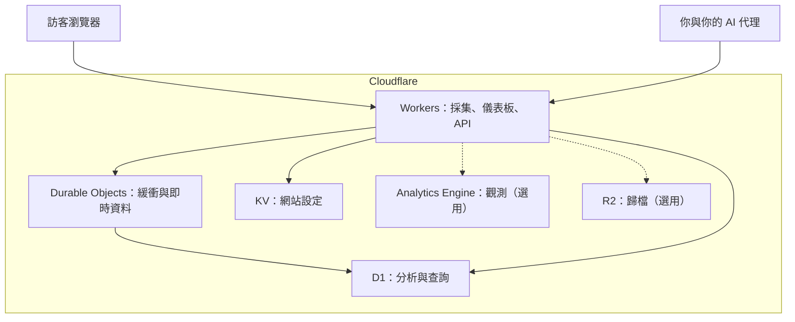

<div align="center">

<a href="https://insightflare.net/zh-tw?utm_source=github&amp;utm_medium=referral&amp;utm_campaign=website&amp;utm_content=readme_logo"></a>

# InsightFlare

### 網站統計的輕，產品分析的深。

一段不到 4 KB 的指令碼，在同一個儀表板中了解流量、訪客旅程、漏斗、留存與依行為劃分的受眾。部署在你自己的 Cloudflare 帳戶中，無須維護伺服器。

[官方網站](https://insightflare.net/zh-tw?utm_source=github&utm_medium=referral&utm_campaign=website&utm_content=readme_header) · [使用文件](https://insightflare.net/zh-tw/docs?utm_source=github&utm_medium=referral&utm_campaign=docs&utm_content=readme_header) · [線上展示](https://demo.insightflare.net/zh-tw/app/xeoos-team/dailypulse-news?utm_source=github&utm_medium=referral&utm_campaign=demo&utm_content=readme_header)

[](https://deploy.insightflare.net/zh-tw?utm_source=github&utm_medium=referral&utm_campaign=deploy&utm_content=readme_hero)

[](https://github.com/RavelloH/InsightFlare/stargazers) [](https://github.com/RavelloH/InsightFlare/releases) [](/LICENSE)

<!-- auto-readme-i18n-switcher start -->
| [English](/.github/readme/README.en.md) | [日本語](/.github/readme/README.ja.md) | 中文（台灣） | [中文](/.github/readme/README.zh.md) |
<!-- auto-readme-i18n-switcher end -->

</div>

<a href="https://demo.insightflare.net/zh-tw/app/xeoos-team/dailypulse-news?utm_source=github&amp;utm_medium=referral&amp;utm_campaign=demo&amp;utm_content=readme_screenshot"></a>

<div align="center">

<table>
  <tr>
    <td width="33%" align="center"><br>追蹤指令碼大小</td>
    <td width="33%" align="center"><br>免費帳戶實測每日事件量</td>
    <td width="33%" align="center"><br>軟體授權費用</td>
  </tr>
</table>

</div>

## 為什麼選擇 InsightFlare？

- **新增一段指令碼，自動開始統計。** 不到 4 KB 的無 Cookie 指令碼自動採集網頁瀏覽、來源、UTM、裝置、地區及 Core Web Vitals；修改追蹤設定無須重新發布前端。
- **從同一份資料看見全貌。** 在同一個儀表板中了解即時訪客、網頁、行銷管道與真實使用者效能。
- **每張報表都能直接比較。** 指標卡、趨勢圖、表格、漏斗與留存均可在原位置顯示比較資料；為比較設定獨立篩選條件，直接比較兩群訪客。
- **產品分析功能，不按事件收取軟體費用。** 從帶屬性的自訂事件，到轉換漏斗、目標及群組留存，無須另外訂閱產品分析平台。
- **用進階篩選精確圈定受眾。** 依訪客做過什麼、做了幾次、順序與間隔來篩選。透過視覺化建構器或運算式組合巢狀 AND / OR / NOT、事件屬性、聚合與有序行為序列；篩選後，從趨勢到留存的適用報表皆聚焦這群人。
- **每位訪客，一條完整的時間軸。** 開啟任意訪客，依時間順序查看工作階段、來源、瀏覽網頁、事件與完整事件屬性。
- **讓 AI 代理查詢你的資料。** 透過 Skills、版本化 OpenAPI 與限定權限的 API 金鑰，讓代理分析資料並在授權範圍內管理已儲存的分析。
- **自己的基礎設施，自己的資料。** 一鍵部署至自己的 Cloudflare 帳戶，Workers 自動擴展，訪客識別可設定，自行託管軟體採用 MIT 開源授權。
- **為團隊協作而設計。** 管理多個團隊與網站、分享唯讀報表、設定通知，並單獨觀測機器人流量。

[線上體驗真實進階篩選引擎](https://insightflare.net/zh-tw/features/filters?utm_source=github&utm_medium=referral&utm_campaign=features&utm_content=readme_why_filters) · [了解週期與受眾比較](https://insightflare.net/zh-tw/docs/usage/comparison?utm_source=github&utm_medium=referral&utm_campaign=docs&utm_content=readme_why_compare)

## 快速開始

安裝最新官方建置，無須 Fork、編譯或安裝 Wrangler。

[](https://deploy.insightflare.net/zh-tw?utm_source=github&utm_medium=referral&utm_campaign=deploy&utm_content=readme_quick_start)

1. 連接 Cloudflare，選擇帳戶並確認部署方案。
2. 選擇存取位址及管理員密碼，完成安裝。
3. 登入執行個體，新增網站並將追蹤指令碼加入網頁。
4. 瀏覽你的網站，在即時頁面確認資料到達。

[快速開始](https://insightflare.net/zh-tw/docs/getting-started/quick-start?utm_source=github&utm_medium=referral&utm_campaign=docs&utm_content=readme_guide) · [手動部署](https://insightflare.net/zh-tw/docs/deployment/manual-deployment?utm_source=github&utm_medium=referral&utm_campaign=docs&utm_content=readme_guide)

## 探索功能

<table>
  <tr>
    <td width="50%" valign="top" align="center"><a href="https://insightflare.net/zh-tw/features?utm_source=github&amp;utm_medium=referral&amp;utm_campaign=features&amp;utm_content=readme_traffic"><br><strong>流量與獲客</strong></a><br>即時流量、網頁、來源與行銷活動。</td>
    <td width="50%" valign="top" align="center"><a href="https://insightflare.net/zh-tw/features?utm_source=github&amp;utm_medium=referral&amp;utm_campaign=features&amp;utm_content=readme_journeys"><br><strong>工作階段與訪客旅程</strong></a><br>追蹤瀏覽路徑與自訂事件。</td>
  </tr>
  <tr>
    <td width="50%" valign="top" align="center"><a href="https://insightflare.net/zh-tw/features/funnels?utm_source=github&amp;utm_medium=referral&amp;utm_campaign=features&amp;utm_content=readme_funnels"><br><strong>漏斗與目標</strong></a><br>依工作階段或訪客衡量轉換，找出流失。</td>
    <td width="50%" valign="top" align="center"><a href="https://insightflare.net/zh-tw/features/retention?utm_source=github&amp;utm_medium=referral&amp;utm_campaign=features&amp;utm_content=readme_retention"><br><strong>留存與回訪</strong></a><br>按首次造訪時間分組，了解誰回來了。</td>
  </tr>
  <tr>
    <td width="50%" valign="top" align="center"><a href="https://insightflare.net/zh-tw/features/filters?utm_source=github&amp;utm_medium=referral&amp;utm_campaign=features&amp;utm_content=readme_filters"><br><strong>進階篩選與自訂事件</strong></a><br>透過行為、屬性及順序描述受眾。</td>
    <td width="50%" valign="top" align="center"><a href="https://insightflare.net/zh-tw/features/experience?utm_source=github&amp;utm_medium=referral&amp;utm_campaign=features&amp;utm_content=readme_experience"><br><strong>真實使用者體驗</strong></a><br>Core Web Vitals、瀏覽器與裝置。</td>
  </tr>
  <tr>
    <td width="50%" valign="top" align="center"><a href="https://insightflare.net/zh-tw/features/geo?utm_source=github&amp;utm_medium=referral&amp;utm_campaign=features&amp;utm_content=readme_geo"><br><strong>地理情報</strong></a><br>從國家到城市逐層深入。</td>
    <td width="50%" valign="top" align="center"><a href="https://insightflare.net/zh-tw/features/operations?utm_source=github&amp;utm_medium=referral&amp;utm_campaign=features&amp;utm_content=readme_operations"><br><strong>可觀測性與防護</strong></a><br>請求觀測、機器人規則與運作狀態。</td>
  </tr>
</table>

[探索所有功能](https://insightflare.net/zh-tw/features?utm_source=github&utm_medium=referral&utm_campaign=features&utm_content=readme_gallery)

<details>
<summary>完整功能截圖畫廊（62 張截圖）</summary>

### 流量概覽與來源分析

<table>
  <tr>
    <td width="33%" align="center"><a href="/.github/screenshot/001.webp"></a></td>
    <td width="33%" align="center"><a href="/.github/screenshot/002.webp"></a></td>
    <td width="33%" align="center"><a href="/.github/screenshot/003.webp"></a></td>
  </tr>
  <tr>
    <td width="33%" align="center"><a href="/.github/screenshot/004.webp"></a></td>
    <td width="33%" align="center"><a href="/.github/screenshot/005.webp"></a></td>
    <td width="33%" align="center"><a href="/.github/screenshot/006.webp"></a></td>
  </tr>
  <tr>
    <td width="33%" align="center"><a href="/.github/screenshot/007.webp"></a></td>
    <td width="33%" align="center"><a href="/.github/screenshot/008.webp"></a></td>
    <td width="33%" align="center"><a href="/.github/screenshot/009.webp"></a></td>
  </tr>
  <tr>
    <td width="33%" align="center"><a href="/.github/screenshot/010.webp"></a></td>
    <td width="33%" align="center"><a href="/.github/screenshot/011.webp"></a></td>
    <td width="33%" align="center"><a href="/.github/screenshot/012.webp"></a></td>
  </tr>
  <tr>
    <td width="33%" align="center"><a href="/.github/screenshot/013.webp"></a></td>
    <td width="33%" align="center"><a href="/.github/screenshot/014.webp"></a></td>
    <td width="33%"></td>
  </tr>
</table>

### 事件、工作階段與訪客旅程

<table>
  <tr>
    <td width="33%" align="center"><a href="/.github/screenshot/015.webp"></a></td>
    <td width="33%" align="center"><a href="/.github/screenshot/016.webp"></a></td>
    <td width="33%" align="center"><a href="/.github/screenshot/017.webp"></a></td>
  </tr>
  <tr>
    <td width="33%" align="center"><a href="/.github/screenshot/018.webp"></a></td>
    <td width="33%" align="center"><a href="/.github/screenshot/019.webp"></a></td>
    <td width="33%" align="center"><a href="/.github/screenshot/020.webp"></a></td>
  </tr>
  <tr>
    <td width="33%" align="center"><a href="/.github/screenshot/021.webp"></a></td>
    <td width="33%" align="center"><a href="/.github/screenshot/022.webp"></a></td>
    <td width="33%" align="center"><a href="/.github/screenshot/023.webp"></a></td>
  </tr>
  <tr>
    <td width="33%" align="center"><a href="/.github/screenshot/024.webp"></a></td>
    <td width="33%" align="center"><a href="/.github/screenshot/025.webp"></a></td>
    <td width="33%"></td>
  </tr>
</table>

### 受眾、裝置與地理分析

<table>
  <tr>
    <td width="33%" align="center"><a href="/.github/screenshot/026.webp"></a></td>
    <td width="33%" align="center"><a href="/.github/screenshot/027.webp"></a></td>
    <td width="33%" align="center"><a href="/.github/screenshot/028.webp"></a></td>
  </tr>
  <tr>
    <td width="33%" align="center"><a href="/.github/screenshot/029.webp"></a></td>
    <td width="33%" align="center"><a href="/.github/screenshot/030.webp"></a></td>
    <td width="33%" align="center"><a href="/.github/screenshot/031.webp"></a></td>
  </tr>
  <tr>
    <td width="33%" align="center"><a href="/.github/screenshot/032.webp"></a></td>
    <td width="33%" align="center"><a href="/.github/screenshot/033.webp"></a></td>
    <td width="33%" align="center"><a href="/.github/screenshot/034.webp"></a></td>
  </tr>
  <tr>
    <td width="33%" align="center"><a href="/.github/screenshot/035.webp"></a></td>
    <td width="33%" align="center"><a href="/.github/screenshot/036.webp"></a></td>
    <td width="33%"></td>
  </tr>
</table>

### 設定、團隊協作與分享

<table>
  <tr>
    <td width="33%" align="center"><a href="/.github/screenshot/037.webp"></a></td>
    <td width="33%" align="center"><a href="/.github/screenshot/038.webp"></a></td>
    <td width="33%" align="center"><a href="/.github/screenshot/039.webp"></a></td>
  </tr>
  <tr>
    <td width="33%" align="center"><a href="/.github/screenshot/040.webp"></a></td>
    <td width="33%" align="center"><a href="/.github/screenshot/041.webp"></a></td>
    <td width="33%" align="center"><a href="/.github/screenshot/042.webp"></a></td>
  </tr>
  <tr>
    <td width="33%" align="center"><a href="/.github/screenshot/043.webp"></a></td>
    <td width="33%" align="center"><a href="/.github/screenshot/044.webp"></a></td>
    <td width="33%" align="center"><a href="/.github/screenshot/045.webp"></a></td>
  </tr>
  <tr>
    <td width="33%" align="center"><a href="/.github/screenshot/046.webp"></a></td>
    <td width="33%" align="center"><a href="/.github/screenshot/047.webp"></a></td>
    <td width="33%" align="center"><a href="/.github/screenshot/048.webp"></a></td>
  </tr>
</table>

### 深度事件分析與轉換漏斗

<table>
  <tr>
    <td width="33%" align="center"><a href="/.github/screenshot/049.webp"></a></td>
    <td width="33%" align="center"><a href="/.github/screenshot/050.webp"></a></td>
    <td width="33%" align="center"><a href="/.github/screenshot/051.webp"></a></td>
  </tr>
  <tr>
    <td width="33%" align="center"><a href="/.github/screenshot/052.webp"></a></td>
    <td width="33%" align="center"><a href="/.github/screenshot/053.webp"></a></td>
    <td width="33%" align="center"><a href="/.github/screenshot/054.webp"></a></td>
  </tr>
</table>

### 運作監控、通知與機器人防護

<table>
  <tr>
    <td width="33%" align="center"><a href="/.github/screenshot/055.webp"></a></td>
    <td width="33%" align="center"><a href="/.github/screenshot/056.webp"></a></td>
    <td width="33%" align="center"><a href="/.github/screenshot/057.webp"></a></td>
  </tr>
  <tr>
    <td width="33%" align="center"><a href="/.github/screenshot/058.webp"></a></td>
    <td width="33%" align="center"><a href="/.github/screenshot/059.webp"></a></td>
    <td width="33%" align="center"><a href="/.github/screenshot/060.webp"></a></td>
  </tr>
  <tr>
    <td width="33%" align="center"><a href="/.github/screenshot/061.webp"></a></td>
    <td width="33%" align="center"><a href="/.github/screenshot/062.webp"></a></td>
    <td width="33%"></td>
  </tr>
</table>

</details>

## 讓 AI 代理理解你的資料

透過 Skills 與限定權限的 API 金鑰，讓 Claude Code、Codex、OpenClaw 或自己的程式探索分析資料。將以下指令傳給代理，換成你的執行個體網域：

```text
閱讀 https://your-instance.example.com/.well-known/skills.json，連接這個網站分析系統，並引導我完成授權。
```

> **從定價頁到部署，哪種裝置轉換率更高？行動裝置在哪一步流失？**
>
> 代理可以比較裝置漏斗、檢查效能及流量來源，並在具備相應權限時儲存漏斗，以便後續比較。

[AI 代理接入](https://insightflare.net/zh-tw/docs/ai-and-api/connect-an-agent?utm_source=github&utm_medium=referral&utm_campaign=docs&utm_content=readme_guide) · [API 參考](https://insightflare.net/zh-tw/docs/api?utm_source=github&utm_medium=referral&utm_campaign=docs&utm_content=readme_guide)

## 自行託管與成本

InsightFlare 運行在 Cloudflare Workers、Durable Objects、D1 與 KV 上，Analytics Engine 和 R2 為選用項目。採集資料經過緩衝及批次寫入，由邊緣網路提供採集及儀表板服務。



**免費 Cloudflare 帳戶實測每日 10,000+ 事件。** 實際用量取決於流量、查詢頻率、資料規模與方案限制。

[了解部署架構、效能與成本](https://insightflare.net/zh-tw/self-hosting?utm_source=github&utm_medium=referral&utm_campaign=website&utm_content=readme_cost)

## 隱私與資料自主

追蹤器不設定也不讀取 Cookie，正常訪客的原始 IP 不隨造訪記錄儲存。啟用 Analytics Engine 後，被判定為機器人且遭攔截的請求可能記錄 IP，以便排查。您也可以在網站設定中變更追蹤模式，以適應適用法規。

[成本與隱私](https://insightflare.net/zh-tw/docs/getting-started/cost-and-privacy?utm_source=github&utm_medium=referral&utm_campaign=docs&utm_content=readme_guide) · [訪客識別機制](https://insightflare.net/zh-tw/docs/tracking/privacy?utm_source=github&utm_medium=referral&utm_campaign=docs&utm_content=readme_guide)

## 使用文件

<table>
  <tr>
    <td><strong>開始使用</strong></td>
    <td><a href="https://insightflare.net/zh-tw/docs/getting-started/quick-start?utm_source=github&amp;utm_medium=referral&amp;utm_campaign=docs&amp;utm_content=readme_guide">快速開始</a> · <a href="https://insightflare.net/zh-tw/docs/tracking?utm_source=github&amp;utm_medium=referral&amp;utm_campaign=docs&amp;utm_content=readme_guide">安裝指令碼</a> · <a href="https://insightflare.net/zh-tw/docs/getting-started/cost-and-privacy?utm_source=github&amp;utm_medium=referral&amp;utm_campaign=docs&amp;utm_content=readme_guide">成本與隱私</a></td>
  </tr>
  <tr>
    <td><strong>資料分析</strong></td>
    <td><a href="https://insightflare.net/zh-tw/docs/usage/filters?utm_source=github&amp;utm_medium=referral&amp;utm_campaign=docs&amp;utm_content=readme_guide">進階篩選</a> · <a href="https://insightflare.net/zh-tw/docs/usage/funnels-and-goals?utm_source=github&amp;utm_medium=referral&amp;utm_campaign=docs&amp;utm_content=readme_guide">漏斗與目標</a> · <a href="https://insightflare.net/zh-tw/docs/usage/retention?utm_source=github&amp;utm_medium=referral&amp;utm_campaign=docs&amp;utm_content=readme_guide">留存分析</a></td>
  </tr>
  <tr>
    <td><strong>資料採集</strong></td>
    <td><a href="https://insightflare.net/zh-tw/docs/tracking/custom-events?utm_source=github&amp;utm_medium=referral&amp;utm_campaign=docs&amp;utm_content=readme_guide">自訂事件</a> · <a href="https://insightflare.net/zh-tw/docs/tracking/identify?utm_source=github&amp;utm_medium=referral&amp;utm_campaign=docs&amp;utm_content=readme_guide">使用者識別</a> · <a href="https://insightflare.net/zh-tw/docs/tracking/tracking-settings?utm_source=github&amp;utm_medium=referral&amp;utm_campaign=docs&amp;utm_content=readme_guide">追蹤設定</a></td>
  </tr>
  <tr>
    <td><strong>部署與維運</strong></td>
    <td><a href="https://insightflare.net/zh-tw/docs/deployment/updating?utm_source=github&amp;utm_medium=referral&amp;utm_campaign=docs&amp;utm_content=readme_guide">更新指南</a> · <a href="https://insightflare.net/zh-tw/docs/deployment/analytics-engine?utm_source=github&amp;utm_medium=referral&amp;utm_campaign=docs&amp;utm_content=readme_guide">Analytics Engine</a> · <a href="https://insightflare.net/zh-tw/docs/deployment/manual-deployment?utm_source=github&amp;utm_medium=referral&amp;utm_campaign=docs&amp;utm_content=readme_guide">手動部署</a></td>
  </tr>
  <tr>
    <td><strong>整合與開發</strong></td>
    <td><a href="https://insightflare.net/zh-tw/docs/ai-and-api/connect-an-agent?utm_source=github&amp;utm_medium=referral&amp;utm_campaign=docs&amp;utm_content=readme_guide">AI 代理接入</a> · <a href="https://insightflare.net/zh-tw/docs/api?utm_source=github&amp;utm_medium=referral&amp;utm_campaign=docs&amp;utm_content=readme_guide">API 參考</a> · <a href="https://insightflare.net/zh-tw/docs/deployment/local-development?utm_source=github&amp;utm_medium=referral&amp;utm_campaign=docs&amp;utm_content=readme_guide">本機開發</a></td>
  </tr>
</table>

[設定參考](https://insightflare.net/zh-tw/docs/reference/configuration?utm_source=github&utm_medium=referral&utm_campaign=docs&utm_content=readme_guide) · [R2 歸檔](https://insightflare.net/zh-tw/docs/deployment/r2-archive?utm_source=github&utm_medium=referral&utm_campaign=docs&utm_content=readme_guide) · [指令參考](https://insightflare.net/zh-tw/docs/reference/commands?utm_source=github&utm_medium=referral&utm_campaign=docs&utm_content=readme_guide) · [常見問題](https://insightflare.net/zh-tw/docs/reference/faq?utm_source=github&utm_medium=referral&utm_campaign=docs&utm_content=readme_guide)

## 本機開發

**TypeScript · React · TanStack Start · Cloudflare Workers · D1 · Durable Objects**

環境需求：Node.js 24、pnpm 10.33。啟動前依本機開發指南設定 .dev.vars。

```bash
git clone https://github.com/RavelloH/InsightFlare
cd InsightFlare
pnpm install
pnpm run db:migrate:local
cp .dev.vars.example .dev.vars
```

設定環境變數後執行：

```bash
pnpm run dev
```

僅開發 UI 時，可執行 `pnpm run dev:ui` 使用 Demo Mode，無須資料庫與金鑰。

[本機開發](https://insightflare.net/zh-tw/docs/deployment/local-development?utm_source=github&utm_medium=referral&utm_campaign=docs&utm_content=readme_guide) · [貢獻指南](/CONTRIBUTING.md)

## 社群與生態

InsightFlare 的配套開源專案由組織及作者維護，也可獨立使用。

<table>
  <tr>
    <td><a href="https://github.com/InsightFlare/deploy"><strong>Deploy</strong></a></td>
    <td>一鍵安裝與更新。</td>
  </tr>
  <tr>
    <td><a href="https://github.com/InsightFlare/asn-blocklist"><strong>asn-blocklist</strong></a></td>
    <td>基於 PeeringDB 的 ASN 分類。</td>
  </tr>
  <tr>
    <td><a href="https://github.com/InsightFlare/map-relay"><strong>map-relay</strong></a></td>
    <td>CARTO 向量底圖代理。</td>
  </tr>
  <tr>
    <td><a href="https://github.com/RavelloH/can-i-use-api"><strong>can-i-use-api</strong></a></td>
    <td>Can I Use 靜態相容性 API。</td>
  </tr>
  <tr>
    <td><a href="https://github.com/RavelloH/iso-3166-2-locale"><strong>iso-3166-2-locale</strong></a></td>
    <td>多語言地名詞典。</td>
  </tr>
  <tr>
    <td><a href="https://gist.github.com/RavelloH/08cdb1493d09d2ad1eb0cf17d06e3078"><strong>meta</strong></a></td>
    <td>網頁中繼資料擷取（Gist）。</td>
  </tr>
</table>

[了解配套開源專案](https://insightflare.net/zh-tw/open-source?utm_source=github&utm_medium=referral&utm_campaign=website&utm_content=readme_ecosystem)

[官方組織](https://github.com/InsightFlare) · [回報問題](https://github.com/RavelloH/InsightFlare/issues) · [貢獻指南](/CONTRIBUTING.md) · [版本發布](https://github.com/RavelloH/InsightFlare/releases)

## 授權條款

[MIT](/LICENSE) Copyright 2026 RavelloH

---

<div align="center">

### 開始了解你的使用者。

[](https://deploy.insightflare.net/zh-tw?utm_source=github&utm_medium=referral&utm_campaign=deploy&utm_content=readme_footer)

[官方網站](https://insightflare.net/zh-tw?utm_source=github&utm_medium=referral&utm_campaign=website&utm_content=readme_footer) · [線上展示](https://demo.insightflare.net/zh-tw/app/xeoos-team/dailypulse-news?utm_source=github&utm_medium=referral&utm_campaign=demo&utm_content=readme_footer)

</div>
