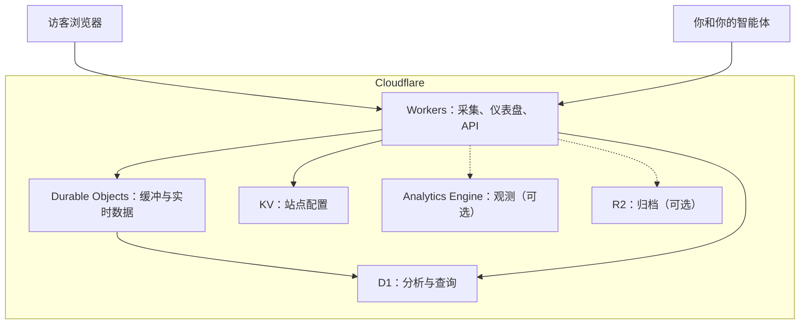

<div align="center">

<a href="https://insightflare.net/zh?utm_source=github&amp;utm_medium=referral&amp;utm_campaign=website&amp;utm_content=readme_logo"></a>

# InsightFlare

### 网站统计的轻，产品分析的深。

一段不到 4 KB 的脚本，在同一个仪表盘中了解流量、访客旅程、漏斗、留存和按行为划分的人群。部署在你自己的 Cloudflare 账户中，无需维护服务器。

[官方网站](https://insightflare.net/zh?utm_source=github&utm_medium=referral&utm_campaign=website&utm_content=readme_header) · [使用文档](https://insightflare.net/zh/docs?utm_source=github&utm_medium=referral&utm_campaign=docs&utm_content=readme_header) · [在线演示](https://demo.insightflare.net/zh/app/xeoos-team/dailypulse-news?utm_source=github&utm_medium=referral&utm_campaign=demo&utm_content=readme_header)

[](https://deploy.insightflare.net/zh?utm_source=github&utm_medium=referral&utm_campaign=deploy&utm_content=readme_hero)

[](https://github.com/RavelloH/InsightFlare/stargazers) [](https://github.com/RavelloH/InsightFlare/releases) [](/LICENSE)

<!-- auto-readme-i18n-switcher start -->
| [English](/.github/readme/README.en.md) | [日本語](/.github/readme/README.ja.md) | [中文（台灣）](/.github/readme/README.zh-tw.md) | 中文 |
<!-- auto-readme-i18n-switcher end -->

</div>

<a href="https://demo.insightflare.net/zh/app/xeoos-team/dailypulse-news?utm_source=github&amp;utm_medium=referral&amp;utm_campaign=demo&amp;utm_content=readme_screenshot"></a>

<div align="center">

<table>
  <tr>
    <td width="33%" align="center"><br>采集脚本大小</td>
    <td width="33%" align="center"><br>免费账户实测每日事件量</td>
    <td width="33%" align="center"><br>软件授权费用</td>
  </tr>
</table>

</div>

## 为什么选择 InsightFlare？

- **添加一段脚本，自动开始统计。** 不到 4 KB 的无 Cookie 脚本自动采集页面浏览、来源、UTM、设备、地区和 Core Web Vitals；修改追踪设置无需重新发布前端。
- **从同一份数据看见全貌。** 在同一个仪表盘中了解实时访客、页面、推广渠道与真实用户性能。
- **每张报表都能直接对比。** 指标卡、趋势图、表格、漏斗与留存均可在原位置展示对比数据；为对比设置独立筛选条件，直接比较两群访客。
- **产品分析功能，不按事件收取软件费用。** 从带属性的自定义事件，到转化漏斗、目标和群组留存，无需另行订阅产品分析平台。
- **用高级筛选精确圈定人群。** 按访客做过什么、做了几次、顺序如何、间隔多久来筛选。通过可视化构建器或表达式组合嵌套 AND / OR / NOT、事件属性、聚合与有序行为序列；圈定后，从趋势到留存的适用报表均聚焦这群人。
- **每位访客，一条完整的时间线。** 打开任意访客，按时间顺序查看会话、来源、浏览页面、事件和完整事件属性。
- **让 AI 智能体查询你的数据。** 通过 Skills、带版本的 OpenAPI 和限定权限的 API 密钥，让智能体分析数据，并在授权范围内管理已保存的分析。
- **自己的基础设施，自己的数据。** 一键部署至自己的 Cloudflare 账户，Workers 自动扩展，访客识别可配置，自托管软件采用 MIT 开源许可证。
- **为团队协作而设计。** 管理多个团队与站点、分享只读报表、配置通知，并单独观测机器人流量。

[在线体验真实高级筛选引擎](https://insightflare.net/zh/features/filters?utm_source=github&utm_medium=referral&utm_campaign=features&utm_content=readme_why_filters) · [了解周期与人群对比](https://insightflare.net/zh/docs/usage/comparison?utm_source=github&utm_medium=referral&utm_campaign=docs&utm_content=readme_why_compare)

## 快速开始

安装最新官方构建，无需 Fork、编译或安装 Wrangler。

[](https://deploy.insightflare.net/zh?utm_source=github&utm_medium=referral&utm_campaign=deploy&utm_content=readme_quick_start)

1. 连接 Cloudflare，选择账户并确认部署方案。
2. 选择访问地址和管理员密码，完成安装。
3. 登录实例，添加站点，将统计脚本添加到网页。
4. 访问你的网站，在实时页面确认数据到达。

[快速开始](https://insightflare.net/zh/docs/getting-started/quick-start?utm_source=github&utm_medium=referral&utm_campaign=docs&utm_content=readme_guide) · [手动部署](https://insightflare.net/zh/docs/deployment/manual-deployment?utm_source=github&utm_medium=referral&utm_campaign=docs&utm_content=readme_guide)

## 探索功能

<table>
  <tr>
    <td width="50%" valign="top" align="center"><a href="https://insightflare.net/zh/features?utm_source=github&amp;utm_medium=referral&amp;utm_campaign=features&amp;utm_content=readme_traffic"><br><strong>流量与获客</strong></a><br>实时流量、页面、来源与推广活动。</td>
    <td width="50%" valign="top" align="center"><a href="https://insightflare.net/zh/features?utm_source=github&amp;utm_medium=referral&amp;utm_campaign=features&amp;utm_content=readme_journeys"><br><strong>会话与访客旅程</strong></a><br>追踪访问路径和自定义事件。</td>
  </tr>
  <tr>
    <td width="50%" valign="top" align="center"><a href="https://insightflare.net/zh/features/funnels?utm_source=github&amp;utm_medium=referral&amp;utm_campaign=features&amp;utm_content=readme_funnels"><br><strong>漏斗与目标</strong></a><br>按会话或访客衡量转化，定位流失。</td>
    <td width="50%" valign="top" align="center"><a href="https://insightflare.net/zh/features/retention?utm_source=github&amp;utm_medium=referral&amp;utm_campaign=features&amp;utm_content=readme_retention"><br><strong>留存与回访</strong></a><br>按首次访问时间分组，了解谁回来了。</td>
  </tr>
  <tr>
    <td width="50%" valign="top" align="center"><a href="https://insightflare.net/zh/features/filters?utm_source=github&amp;utm_medium=referral&amp;utm_campaign=features&amp;utm_content=readme_filters"><br><strong>高级筛选与自定义事件</strong></a><br>通过行为、属性和顺序描述一群用户。</td>
    <td width="50%" valign="top" align="center"><a href="https://insightflare.net/zh/features/experience?utm_source=github&amp;utm_medium=referral&amp;utm_campaign=features&amp;utm_content=readme_experience"><br><strong>真实用户体验</strong></a><br>Core Web Vitals、浏览器与设备。</td>
  </tr>
  <tr>
    <td width="50%" valign="top" align="center"><a href="https://insightflare.net/zh/features/geo?utm_source=github&amp;utm_medium=referral&amp;utm_campaign=features&amp;utm_content=readme_geo"><br><strong>地理情报</strong></a><br>从国家到城市逐级下钻。</td>
    <td width="50%" valign="top" align="center"><a href="https://insightflare.net/zh/features/operations?utm_source=github&amp;utm_medium=referral&amp;utm_campaign=features&amp;utm_content=readme_operations"><br><strong>可观测性与防护</strong></a><br>请求观测、机器人规则及运行状态。</td>
  </tr>
</table>

[探索全部功能](https://insightflare.net/zh/features?utm_source=github&utm_medium=referral&utm_campaign=features&utm_content=readme_gallery)

<details>
<summary>完整功能截图画廊（62 张截图）</summary>

### 流量概览与来源分析

<table>
  <tr>
    <td width="33%" align="center"><a href="/.github/screenshot/001.webp"></a></td>
    <td width="33%" align="center"><a href="/.github/screenshot/002.webp"></a></td>
    <td width="33%" align="center"><a href="/.github/screenshot/003.webp"></a></td>
  </tr>
  <tr>
    <td width="33%" align="center"><a href="/.github/screenshot/004.webp"></a></td>
    <td width="33%" align="center"><a href="/.github/screenshot/005.webp"></a></td>
    <td width="33%" align="center"><a href="/.github/screenshot/006.webp"></a></td>
  </tr>
  <tr>
    <td width="33%" align="center"><a href="/.github/screenshot/007.webp"></a></td>
    <td width="33%" align="center"><a href="/.github/screenshot/008.webp"></a></td>
    <td width="33%" align="center"><a href="/.github/screenshot/009.webp"></a></td>
  </tr>
  <tr>
    <td width="33%" align="center"><a href="/.github/screenshot/010.webp"></a></td>
    <td width="33%" align="center"><a href="/.github/screenshot/011.webp"></a></td>
    <td width="33%" align="center"><a href="/.github/screenshot/012.webp"></a></td>
  </tr>
  <tr>
    <td width="33%" align="center"><a href="/.github/screenshot/013.webp"></a></td>
    <td width="33%" align="center"><a href="/.github/screenshot/014.webp"></a></td>
    <td width="33%"></td>
  </tr>
</table>

### 事件、会话与访客旅程

<table>
  <tr>
    <td width="33%" align="center"><a href="/.github/screenshot/015.webp"></a></td>
    <td width="33%" align="center"><a href="/.github/screenshot/016.webp"></a></td>
    <td width="33%" align="center"><a href="/.github/screenshot/017.webp"></a></td>
  </tr>
  <tr>
    <td width="33%" align="center"><a href="/.github/screenshot/018.webp"></a></td>
    <td width="33%" align="center"><a href="/.github/screenshot/019.webp"></a></td>
    <td width="33%" align="center"><a href="/.github/screenshot/020.webp"></a></td>
  </tr>
  <tr>
    <td width="33%" align="center"><a href="/.github/screenshot/021.webp"></a></td>
    <td width="33%" align="center"><a href="/.github/screenshot/022.webp"></a></td>
    <td width="33%" align="center"><a href="/.github/screenshot/023.webp"></a></td>
  </tr>
  <tr>
    <td width="33%" align="center"><a href="/.github/screenshot/024.webp"></a></td>
    <td width="33%" align="center"><a href="/.github/screenshot/025.webp"></a></td>
    <td width="33%"></td>
  </tr>
</table>

### 受众、设备与地理分析

<table>
  <tr>
    <td width="33%" align="center"><a href="/.github/screenshot/026.webp"></a></td>
    <td width="33%" align="center"><a href="/.github/screenshot/027.webp"></a></td>
    <td width="33%" align="center"><a href="/.github/screenshot/028.webp"></a></td>
  </tr>
  <tr>
    <td width="33%" align="center"><a href="/.github/screenshot/029.webp"></a></td>
    <td width="33%" align="center"><a href="/.github/screenshot/030.webp"></a></td>
    <td width="33%" align="center"><a href="/.github/screenshot/031.webp"></a></td>
  </tr>
  <tr>
    <td width="33%" align="center"><a href="/.github/screenshot/032.webp"></a></td>
    <td width="33%" align="center"><a href="/.github/screenshot/033.webp"></a></td>
    <td width="33%" align="center"><a href="/.github/screenshot/034.webp"></a></td>
  </tr>
  <tr>
    <td width="33%" align="center"><a href="/.github/screenshot/035.webp"></a></td>
    <td width="33%" align="center"><a href="/.github/screenshot/036.webp"></a></td>
    <td width="33%"></td>
  </tr>
</table>

### 设置、团队协作与分享

<table>
  <tr>
    <td width="33%" align="center"><a href="/.github/screenshot/037.webp"></a></td>
    <td width="33%" align="center"><a href="/.github/screenshot/038.webp"></a></td>
    <td width="33%" align="center"><a href="/.github/screenshot/039.webp"></a></td>
  </tr>
  <tr>
    <td width="33%" align="center"><a href="/.github/screenshot/040.webp"></a></td>
    <td width="33%" align="center"><a href="/.github/screenshot/041.webp"></a></td>
    <td width="33%" align="center"><a href="/.github/screenshot/042.webp"></a></td>
  </tr>
  <tr>
    <td width="33%" align="center"><a href="/.github/screenshot/043.webp"></a></td>
    <td width="33%" align="center"><a href="/.github/screenshot/044.webp"></a></td>
    <td width="33%" align="center"><a href="/.github/screenshot/045.webp"></a></td>
  </tr>
  <tr>
    <td width="33%" align="center"><a href="/.github/screenshot/046.webp"></a></td>
    <td width="33%" align="center"><a href="/.github/screenshot/047.webp"></a></td>
    <td width="33%" align="center"><a href="/.github/screenshot/048.webp"></a></td>
  </tr>
</table>

### 深度事件分析与转化漏斗

<table>
  <tr>
    <td width="33%" align="center"><a href="/.github/screenshot/049.webp"></a></td>
    <td width="33%" align="center"><a href="/.github/screenshot/050.webp"></a></td>
    <td width="33%" align="center"><a href="/.github/screenshot/051.webp"></a></td>
  </tr>
  <tr>
    <td width="33%" align="center"><a href="/.github/screenshot/052.webp"></a></td>
    <td width="33%" align="center"><a href="/.github/screenshot/053.webp"></a></td>
    <td width="33%" align="center"><a href="/.github/screenshot/054.webp"></a></td>
  </tr>
</table>

### 运行监控、通知与机器人防护

<table>
  <tr>
    <td width="33%" align="center"><a href="/.github/screenshot/055.webp"></a></td>
    <td width="33%" align="center"><a href="/.github/screenshot/056.webp"></a></td>
    <td width="33%" align="center"><a href="/.github/screenshot/057.webp"></a></td>
  </tr>
  <tr>
    <td width="33%" align="center"><a href="/.github/screenshot/058.webp"></a></td>
    <td width="33%" align="center"><a href="/.github/screenshot/059.webp"></a></td>
    <td width="33%" align="center"><a href="/.github/screenshot/060.webp"></a></td>
  </tr>
  <tr>
    <td width="33%" align="center"><a href="/.github/screenshot/061.webp"></a></td>
    <td width="33%" align="center"><a href="/.github/screenshot/062.webp"></a></td>
    <td width="33%"></td>
  </tr>
</table>

</details>

## 让 AI 智能体理解你的数据

通过 Skills 和限定权限的 API 密钥，让 Claude Code、Codex、OpenClaw 或自己的程序探索分析数据。将以下指令发送给智能体，替换为你的实例域名：

```text
阅读 https://your-instance.example.com/.well-known/skills.json，连接这个网站分析系统，并引导我完成授权。
```

> **从定价页到部署，哪种设备转化更好？移动端具体在哪一步流失？**
>
> 智能体可以对比设备漏斗、检查性能与流量来源，并在具备相应权限时保存漏斗，以便后续对比。

[智能体接入](https://insightflare.net/zh/docs/ai-and-api/connect-an-agent?utm_source=github&utm_medium=referral&utm_campaign=docs&utm_content=readme_guide) · [API 参考](https://insightflare.net/zh/docs/api?utm_source=github&utm_medium=referral&utm_campaign=docs&utm_content=readme_guide)

## 自托管与成本

InsightFlare 运行在 Cloudflare Workers、Durable Objects、D1 和 KV 上，Analytics Engine 与 R2 为可选项。采集数据经过缓冲和批量写入，采集与仪表盘由边缘网络提供服务。



**免费 Cloudflare 账户实测每日 10,000+ 事件。** 实际用量取决于流量、查询频率、数据规模和套餐限制。

[了解部署架构、性能与成本](https://insightflare.net/zh/self-hosting?utm_source=github&utm_medium=referral&utm_campaign=website&utm_content=readme_cost)

## 隐私与数据自主

追踪器不设置也不读取 Cookie，正常访客的原始 IP 不随访问记录保存。启用 Analytics Engine 后，被判定为机器人且遭到拦截的请求可能记录 IP，以便排查。您也可以在站点设置内更改追踪模式，来适配适用法规。

[成本与隐私](https://insightflare.net/zh/docs/getting-started/cost-and-privacy?utm_source=github&utm_medium=referral&utm_campaign=docs&utm_content=readme_guide) · [访客识别机制](https://insightflare.net/zh/docs/tracking/privacy?utm_source=github&utm_medium=referral&utm_campaign=docs&utm_content=readme_guide)

## 使用文档

<table>
  <tr>
    <td><strong>开始使用</strong></td>
    <td><a href="https://insightflare.net/zh/docs/getting-started/quick-start?utm_source=github&amp;utm_medium=referral&amp;utm_campaign=docs&amp;utm_content=readme_guide">快速开始</a> · <a href="https://insightflare.net/zh/docs/tracking?utm_source=github&amp;utm_medium=referral&amp;utm_campaign=docs&amp;utm_content=readme_guide">安装脚本</a> · <a href="https://insightflare.net/zh/docs/getting-started/cost-and-privacy?utm_source=github&amp;utm_medium=referral&amp;utm_campaign=docs&amp;utm_content=readme_guide">成本与隐私</a></td>
  </tr>
  <tr>
    <td><strong>数据分析</strong></td>
    <td><a href="https://insightflare.net/zh/docs/usage/filters?utm_source=github&amp;utm_medium=referral&amp;utm_campaign=docs&amp;utm_content=readme_guide">高级筛选</a> · <a href="https://insightflare.net/zh/docs/usage/funnels-and-goals?utm_source=github&amp;utm_medium=referral&amp;utm_campaign=docs&amp;utm_content=readme_guide">漏斗与目标</a> · <a href="https://insightflare.net/zh/docs/usage/retention?utm_source=github&amp;utm_medium=referral&amp;utm_campaign=docs&amp;utm_content=readme_guide">留存分析</a></td>
  </tr>
  <tr>
    <td><strong>数据采集</strong></td>
    <td><a href="https://insightflare.net/zh/docs/tracking/custom-events?utm_source=github&amp;utm_medium=referral&amp;utm_campaign=docs&amp;utm_content=readme_guide">自定义事件</a> · <a href="https://insightflare.net/zh/docs/tracking/identify?utm_source=github&amp;utm_medium=referral&amp;utm_campaign=docs&amp;utm_content=readme_guide">用户识别</a> · <a href="https://insightflare.net/zh/docs/tracking/tracking-settings?utm_source=github&amp;utm_medium=referral&amp;utm_campaign=docs&amp;utm_content=readme_guide">跟踪设置</a></td>
  </tr>
  <tr>
    <td><strong>部署与运维</strong></td>
    <td><a href="https://insightflare.net/zh/docs/deployment/updating?utm_source=github&amp;utm_medium=referral&amp;utm_campaign=docs&amp;utm_content=readme_guide">更新指南</a> · <a href="https://insightflare.net/zh/docs/deployment/analytics-engine?utm_source=github&amp;utm_medium=referral&amp;utm_campaign=docs&amp;utm_content=readme_guide">Analytics Engine</a> · <a href="https://insightflare.net/zh/docs/deployment/manual-deployment?utm_source=github&amp;utm_medium=referral&amp;utm_campaign=docs&amp;utm_content=readme_guide">手动部署</a></td>
  </tr>
  <tr>
    <td><strong>集成与开发</strong></td>
    <td><a href="https://insightflare.net/zh/docs/ai-and-api/connect-an-agent?utm_source=github&amp;utm_medium=referral&amp;utm_campaign=docs&amp;utm_content=readme_guide">智能体接入</a> · <a href="https://insightflare.net/zh/docs/api?utm_source=github&amp;utm_medium=referral&amp;utm_campaign=docs&amp;utm_content=readme_guide">API 参考</a> · <a href="https://insightflare.net/zh/docs/deployment/local-development?utm_source=github&amp;utm_medium=referral&amp;utm_campaign=docs&amp;utm_content=readme_guide">本地开发</a></td>
  </tr>
</table>

[配置参考](https://insightflare.net/zh/docs/reference/configuration?utm_source=github&utm_medium=referral&utm_campaign=docs&utm_content=readme_guide) · [R2 归档](https://insightflare.net/zh/docs/deployment/r2-archive?utm_source=github&utm_medium=referral&utm_campaign=docs&utm_content=readme_guide) · [命令参考](https://insightflare.net/zh/docs/reference/commands?utm_source=github&utm_medium=referral&utm_campaign=docs&utm_content=readme_guide) · [常见问题](https://insightflare.net/zh/docs/reference/faq?utm_source=github&utm_medium=referral&utm_campaign=docs&utm_content=readme_guide)

## 本地开发

**TypeScript · React · TanStack Start · Cloudflare Workers · D1 · Durable Objects**

环境要求：Node.js 24、pnpm 10.33。启动前按本地开发指南配置 .dev.vars。

```bash
git clone https://github.com/RavelloH/InsightFlare
cd InsightFlare
pnpm install
pnpm run db:migrate:local
cp .dev.vars.example .dev.vars
```

配置环境变量后运行：

```bash
pnpm run dev
```

仅开发 UI 时，可运行 `pnpm run dev:ui` 使用 Demo Mode，无需数据库和密钥。

[本地开发](https://insightflare.net/zh/docs/deployment/local-development?utm_source=github&utm_medium=referral&utm_campaign=docs&utm_content=readme_guide) · [贡献指南](/CONTRIBUTING.md)

## 社区与生态

InsightFlare 的配套开源项目由组织及作者维护，也可以独立使用。

<table>
  <tr>
    <td><a href="https://github.com/InsightFlare/deploy"><strong>Deploy</strong></a></td>
    <td>一键安装与更新。</td>
  </tr>
  <tr>
    <td><a href="https://github.com/InsightFlare/asn-blocklist"><strong>asn-blocklist</strong></a></td>
    <td>基于 PeeringDB 的 ASN 分类。</td>
  </tr>
  <tr>
    <td><a href="https://github.com/InsightFlare/map-relay"><strong>map-relay</strong></a></td>
    <td>CARTO 矢量底图代理。</td>
  </tr>
  <tr>
    <td><a href="https://github.com/RavelloH/can-i-use-api"><strong>can-i-use-api</strong></a></td>
    <td>Can I Use 静态兼容性 API。</td>
  </tr>
  <tr>
    <td><a href="https://github.com/RavelloH/iso-3166-2-locale"><strong>iso-3166-2-locale</strong></a></td>
    <td>多语言地名词典。</td>
  </tr>
  <tr>
    <td><a href="https://gist.github.com/RavelloH/08cdb1493d09d2ad1eb0cf17d06e3078"><strong>meta</strong></a></td>
    <td>网页元数据提取（Gist）。</td>
  </tr>
</table>

[了解配套开源项目](https://insightflare.net/zh/open-source?utm_source=github&utm_medium=referral&utm_campaign=website&utm_content=readme_ecosystem)

[官方组织](https://github.com/InsightFlare) · [报告问题](https://github.com/RavelloH/InsightFlare/issues) · [贡献指南](/CONTRIBUTING.md) · [版本发布](https://github.com/RavelloH/InsightFlare/releases)

## 许可证

[MIT](/LICENSE) Copyright 2026 RavelloH

---

<div align="center">

### 开始了解你的用户。

[](https://deploy.insightflare.net/zh?utm_source=github&utm_medium=referral&utm_campaign=deploy&utm_content=readme_footer)

[官方网站](https://insightflare.net/zh?utm_source=github&utm_medium=referral&utm_campaign=website&utm_content=readme_footer) · [在线演示](https://demo.insightflare.net/zh/app/xeoos-team/dailypulse-news?utm_source=github&utm_medium=referral&utm_campaign=demo&utm_content=readme_footer)

</div>
